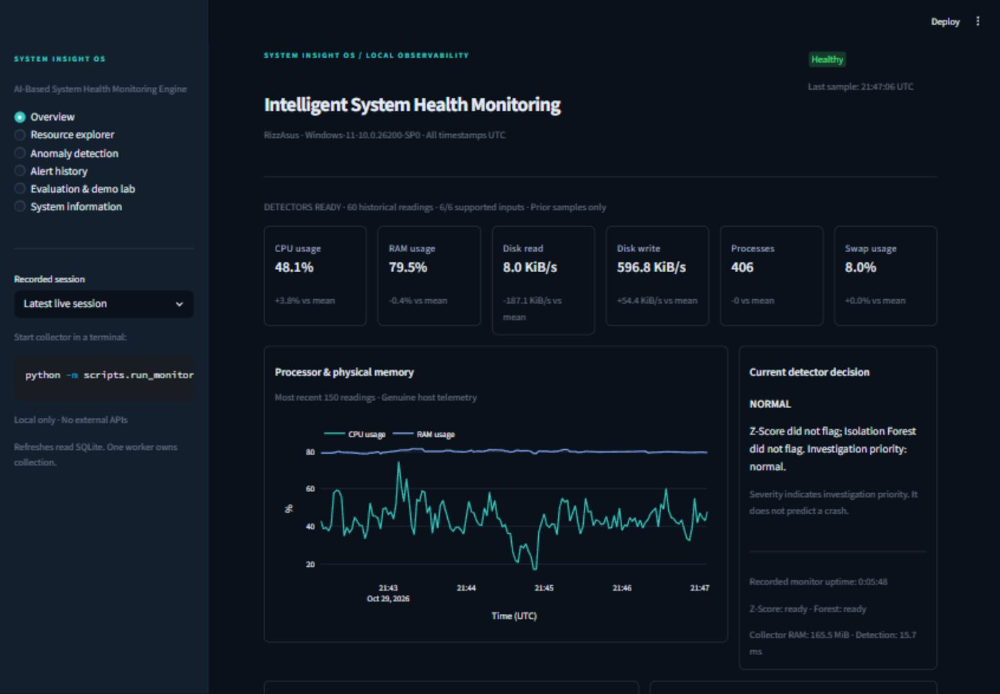

# SYSTEM INSIGHT OS

**AI-Based System Health Monitoring Engine**

Intelligent System Health Monitoring

A local Operating Systems Laboratory application that records real host telemetry, compares each new reading with recent history, and explains unusual resource behaviour. It runs offline after installation. An anomaly means unusual behaviour worth investigating; it does not establish a fault, diagnose a leak or predict a crash.

## Run it

Requires **Python 3.11 or newer** and Git. Internet access is needed for the first dependency installation. Monitoring runs locally afterward without API keys, cloud services or administrator privileges.

Clone the repository and start the application:

```bash
git clone https://github.com/shreyah101/System-Insight-OS.git
cd System-Insight-OS
python run.py
```

On Windows, double-click **run.bat** or use `py -3 run.py` if `python` is not on PATH. On macOS/Linux, use `python3 run.py` or `sh run.sh`.

The first run creates a local `.venv`, installs `requirements.txt`, and starts the collector and dashboard. Later runs reuse that environment. Open the URL printed in the terminal; the launcher chooses a free local port between 8501 and 8511. Keep the terminal open while monitoring and press **Ctrl+C** to stop both components.

Each installation reads its own host's hardware, builds its own baseline and creates a local SQLite database. Displayed timestamps and dashboard downloads use **IST (UTC+05:30)**; stored timestamps and raw CLI exports use UTC.

Optional commands:

```powershell
python run.py --setup-only      # Install without starting monitoring
python run.py --install         # Refresh dependencies, then launch
python run.py --port 8600        # Choose a specific dashboard port
```

If setup is interrupted, rerun the command. On Linux, a missing `venv`/`ensurepip` may require installing the distribution's `python3-venv` package. On Windows, if Python is missing, install it with the PATH option and reopen the terminal. Keep the terminal open while using the app. Missing disk/swap counters on a different laptop display as unavailable; supported metrics still work.

Virtual environments, runtime databases, lock files, exports and local credentials are excluded from version control. A fresh installation starts without existing telemetry or alert history.

For manual setup, open PowerShell in the cloned folder:

```powershell
python -m venv .venv
.\.venv\Scripts\python.exe -m pip install -r requirements.txt
.\.venv\Scripts\python.exe -m scripts.launch
```

Open the local URL printed by Streamlit. Stop the launcher with Ctrl+C. No activation script or execution-policy change is required.

To run the components separately, use two terminals:

```powershell
# Terminal 1: genuine telemetry collector
.\.venv\Scripts\python.exe -m scripts.run_monitor
```

```powershell
# Terminal 2: database-only dashboard
.\.venv\Scripts\python.exe -m streamlit run app.py --server.address 127.0.0.1
```

If the port is occupied, add `--server.port 8502` to the dashboard command. On Linux/macOS, replace `.\.venv\Scripts\python.exe` with `.venv/bin/python`. Run module commands from this repository root.

The dashboard can start before the collector. It shows an offline empty state. Only the collector starts collection; opening another browser tab never starts a worker. At startup, allow about two minutes of valid readings for detection, plus initial counter priming and feature-availability stabilization. The first scored sample follows the 60 historical samples.

## What is implemented

- Six real psutil signals, individual validation and unavailable states.
- Historical rolling means, population standard deviations and signed Z-Scores.
- Actual scikit-learn Isolation Forest with deterministic fitting and incident-aware retraining.
- Five severity levels with factual recorded explanations.
- Deduplicated alert episodes, escalation and consecutive-sample recovery.
- SQLite sessions, complete sample evidence, alerts and workload event logs; WAL transactions and foreign keys.
- One independent worker per canonical database path, graceful shutdown, stale/error states and restart-safe history.
- Six Streamlit pages: Overview, Resource explorer, Anomaly detection, Alert history, Evaluation & demo lab, System information.
- Interactive Plotly charts, baseline bands, filters, evidence inspection, CSV/JSON downloads and historical session selection.
- Reproducible synthetic replay through the same detectors, separate from live data.
- Explicit, bounded, cancellable CPU, memory, temporary disk and process demonstrations.
- Local-session evaluation of detector counts, workload latency, misses, recovery and measured overhead.

## Signals and OS relevance

| Signal | Unit | Interpretation |
|---|---|---|
| CPU | percent | Processor utilization across logical cores; scheduling demand |
| RAM | percent | Physical memory use and allocation pressure |
| Disk read | bytes/second | Read counter delta divided by actual monotonic elapsed time |
| Disk write | bytes/second | Write counter delta divided by actual monotonic elapsed time |
| Processes | count | Existing processes reported by the OS, including sleeping processes |
| Swap | percent | Configured swap use; unavailable when no swap exists |

Disk throughput alone does not prove saturation, and swap percentage is not a paging-rate measurement. Optional read-only process inspection ranks processes by resident RAM.

## Architecture and detection

```text
psutil -> validate / convert rates -> previous rolling window -> Z-Score + Isolation Forest
       -> combine severity -> atomic SQLite sample + episode + heartbeat -> dashboard readers
       -> append sample to in-memory baseline only after a successful database commit
```

The worker has a bounded deque, its own database connection per transaction, and an OS advisory file lock held for its lifetime. Streamlit reads SQLite independently through its own connections. It uses `st.fragment(run_every=...)`, with no infinite UI loop or collector thread.

For every supported metric, `Z = (current - mean) / max(population_std, configured_floor)`. A flag requires `abs(Z) > 3`, strictly. Floors have the same units as the metric: CPU 1 percentage point, RAM/swap 0.1 point, disk rates 4096 B/s, process count 1. These prevent near-constant baselines from producing arbitrary huge scores. Charts use these effective standard deviations; they are descriptive bands, not confidence intervals or physical safety limits.

Isolation Forest fits 100 trees on the previous 60 complete eligible rows, with contamination `auto`, seed 42 and fixed feature order. A negative decision score indicates an outlier, not a probability. Retraining is considered after 30 scored valid samples; an active episode blocks it, and any flag suspends it until 60 consecutive valid unflagged samples have been observed. Fitting always precedes scoring and excludes the current row.

| Priority | Same-reading decision |
|---|---|
| NORMAL | Neither detector flags |
| LOW | Z-Score only; 3 < largest absolute Z <= 4 |
| MEDIUM | Z-Score only; largest absolute Z > 4 |
| HIGH | Isolation Forest only |
| CRITICAL | Both detectors flag |

One host-wide episode per session groups anomalies until five consecutive eligible normal readings establish recovery. Changing affected metrics within that interval continues the episode. The episode retains peak severity, a union of affected resources/detector flags, count, first/latest timestamps, sample references and latest detection evidence. Missing readings break recovery. Stopping a collector does not falsely resolve an incident.

## Configuration and storage

`config.yaml` is the central settings file; invalid settings fail clearly. Relative database paths resolve against this repository, independent of the shell's working directory. CLI tools and the launcher accept `--config PATH`; the dashboard also accepts `SYSTEM_INSIGHT_CONFIG`. The launcher passes the same configuration to both components. Restart processes after changing configuration. Historical views use the settings recorded with the chosen session.

`data/system_insight.sqlite3` is created on first run. Tables:

- `monitor_sessions`: host metadata, source, config, lifecycle and heartbeat.
- `metrics_history`: six numeric inputs, per-detector flags, forest score, readiness, priority and full JSON evidence including baseline, Z-Scores, quality and overhead.
- `alerts`: episode state with foreign keys to first/latest detection samples.
- `workload_events`: requested/actual times, scenario, caps, cancellation and completion status.

Parameterized queries, indexes, five-second busy timeout and short transactions support concurrent readers. History is preserved indefinitely; there is deliberately no destructive reset button. To start a fresh demo without deleting history, configure a new database filename. Back up a stopped database and any remaining WAL files together, or use SQLite's backup API.

## Demonstration and evaluation

In **Evaluation & demo lab**, run a labelled **SIMULATED** scenario: normal baseline, CPU spike, memory growth, disk spike, process increase or multivariate outlier, each followed by recovery. Results come from the real engine, not predetermined badges. Reset clears only that browser session's in-memory simulation.

For a live workload, select the current running session, inspect the caps, tick the confirmation and explicitly start it. Defaults: 20 seconds, 25% duty cycle of one core, 64 MiB allocation, an 8 MiB temporary file with at most 64 MiB total writes, or three sleeping children. The controller runs in an isolated subprocess, checks cancellation and cleans up its own files/children. Sleeping children also have their own timeout. These small changes may not trigger alerts on a capable machine. Do not increase caps to force a desired result.

```powershell
# Deterministic synthetic evaluation, saved separately from live records
python -m scripts.evaluate --scenario "CPU spike" --output output/cpu_replay.json

# Record genuine telemetry for an ordinary-use session
python -m scripts.collect_session --minutes 30 --export output/normal_use.csv

# Evaluate a saved session; replace the ID with one from the dashboard
python -m scripts.evaluate --session SESSION_ID --output output/local_report.json
```

Stop an existing collector before using `collect_session`; the same exclusive worker lock applies. The planned 70-minute study is **not** bundled as completed data. See [evaluation protocol](docs/EVALUATION.md) and [five-minute demonstration](docs/DEMO_GUIDE.md).

## Tests

```powershell
python -m compileall -q src scripts app.py
python -m pip check
python -m pytest -q --cov=src --cov-report=term-missing
```

Tests use controlled inputs, isolated SQLite databases, real detector math, recovery rules, worker lifecycle, tiny bounded demo executions and Streamlit AppTest page/control checks. They do not rely on ambient CPU usage for assertions. `requirements-verified.txt` records the direct package versions used for verification; `requirements.txt` supports a wider compatible range.

## Troubleshooting and limitations

- **Offline/stale:** start the worker; a killed worker is stale after ten seconds. A restart marks the abandoned session interrupted and opens a new session. An unrecovered prior alert remains active in its historical session.
- **Duplicate worker:** stop the original using Ctrl+C. An OS lock releases when a process exits. Do not delete or rename a lock file while a worker owns it.
- **Unavailable disk/swap:** unsupported readings stay NULL, never fabricated zeros. Counter resets invalidate that interval. On some Windows hosts, disk performance counters may be disabled; the other supported signals still work.
- **Feature availability changes:** five consecutive changes trigger a schema reset and a new full warm-up. Transient missing active inputs pause scoring. Schema changes are postponed while an episode is active; if a required feature permanently disappears during an episode, restart into a new session to relearn the supported schema. Missing data cannot prove recovery.
- **Long or slow workloads:** the Z baseline still rolls during incidents and may absorb gradual change. The forest freezes, but its initial distribution can be unrepresentative; fully constant training features may not help it detect new values. Legitimate work can cause frequent alerts with `contamination=auto`.
- **Overhead:** recorded CPU is the monitor process's interval CPU percentage (one full core is 100%); RSS includes Python/NumPy/sklearn. Detection and collection timing exclude SQLite commit time; scheduling lateness reflects missed deadlines. These values are measurements, not performance guarantees.
- **Temporary-directory permissions:** run setup and tests from a writable project folder. If pytest cannot create its temporary directory, specify a fresh writable `--basetemp` location whose parent already exists.
- **Hard-killed demo controller:** normal timeout/cancellation cleans up, but force-killing a process can leave a temporary directory or an unfinished event. Process children self-expire. Unfinished events are excluded from interval evaluation and disclosed in reports; they are never assigned invented end times.
- **Time and history:** dashboard timestamps, chart axes and dashboard downloads use IST (UTC+05:30). SQLite and raw CLI exports retain timezone-aware UTC for consistent analysis. Resource charts cap at 10,000 points, alert lists at 500 episodes, sidebar sessions at 100; full telemetry export remains available. Charts refresh from persisted readings.
- **Scope:** Windows was exercised here. Linux/macOS branches need testing on those platforms. Optional SMD/NAB benchmarks, crash prediction, remote hosts, cloud services and automated process actions are not implemented.

Future work can add explicit user-labelled ordinary-use intervals, long-horizon baselines, richer disk latency counters and properly isolated public-dataset benchmarks. No public-dataset accuracy is claimed.

## Project files

```text
app.py                       Streamlit entry point
run.py / run.bat / run.sh     Local setup and supervised launch
config.yaml                  Validated central settings
requirements*.txt            Supported / verified direct dependencies
src/
  models.py                  Typed sample, baseline and decision records
  config.py                  Configuration and validation
  telemetry.py               Genuine collection and data quality
  detection.py               Rolling window, Z-Score, forest, combination
  display_time.py             IST presentation and download conversion
  storage.py                 SQLite repository and transactional episodes
  runtime.py                 Exclusive worker, cadence, lifecycle and status
  evaluation.py              Replay and measured local evaluation
  workloads.py               Isolated, bounded demo controller
  ui.py                      All six pages, charts and visual system
scripts/                     Launcher, collector, recording and evaluation CLIs
tests/                       Unit, integration and dashboard checks
docs/                        Architecture, demo, evaluation and review notes
data/                        Persistent runtime records (ignored)
.streamlit/config.toml        Offline-friendly dark theme
```

## Verified interface

These are actual captures from the running application. Live host readings and alerts change over time.



[Detector evidence](docs/screenshots/detection.jpg) · [Genuine alert history](docs/screenshots/alert-history.jpg)

See [verification record](docs/VERIFICATION.md) for test counts, measured startup checks and environment limits.

For API semantics, implementation was checked against the primary [psutil reference](https://psutil.io/api/), [Isolation Forest reference](https://scikit-learn.org/stable/modules/generated/sklearn.ensemble.IsolationForest.html) and [Streamlit fragment documentation](https://docs.streamlit.io/develop/api-reference/execution-flow/st.fragment).
